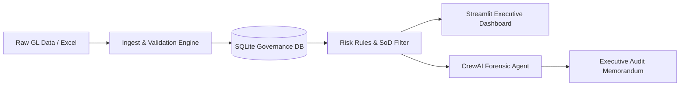

# 🏛️ Veritas — R2R Postings Governance & Forensic Audit Engine

An autonomous, enterprise-grade **Record-to-Report (R2R) General Ledger governance and forensic audit system**. 

Veritas detects high-risk journal entries, evaluates internal control exceptions (SOX compliance, Segregation of Duties), and utilizes an autonomous **CrewAI agent powered by Google Gemini** to analyze risk patterns and draft executive audit memorandums.

---

## 🌟 Key Features

* **Multi-Vector Risk Detection:**
  * **Segregation of Duties (SoD) Violations:** Flags postings where preparer and approver identities overlap or lack clearance.
  * **Off-Hours & Weekend Postings:** Detects anomalous journal entries posted during non-business hours.
  * **Threshold & Round-Sum Spikes:** Identifies transactions deliberately structured just below statutory review limits.
  * **Debit/Credit Imbalance Detection:** Validates double-entry accounting integrity across complex batch postings.

* **Autonomous AI Forensic Auditor (CrewAI + Gemini):**
  * Integrates **CrewAI** with **Google Gemini (`gemini-3.8-flash`)** to query the SQLite governance database.
  * Autonomously extracts risk exceptions, evaluates risk exposure, and generates a structured `Executive_Audit_Memorandum.md`.

* **Interactive Streamlit Executive Dashboard:**
  * **Executive Overview (`appst.py`):** High-density SaaS dashboard featuring risk distribution heatmaps, KPI metrics, and posting drilldowns.
  * **Human-in-the-Loop (HITL) Assistant (`appsthitl.py`):** Interactive natural language query interface for auditors to inspect document IDs and mark items as resolved.

* **Automated Excel Dashboard Exporter:**
  * Formats and exports clean, formatted audit workbooks (`R2R_Audit_Executive_Dashboard.xlsx`) ready for external review.

---

## 📁 Repository Structure

```text
├── appst.py                        # Elite SaaS Dark-themed Streamlit Executive Dashboard
├── appsthitl.py                    # Human-in-the-Loop (HITL) Auditor Review Interface
├── crew_audit_engine.py            # CrewAI + Gemini autonomous forensic audit engine
├── ingest_engine.py                # General Ledger batch staging and ingestion pipeline
├── export_engine.py                # Excel audit dashboard exporter
├── database_setup.py               # Database initialization and schema builder
├── database_and_validation.py      # Core posting validation rules & DB helpers
├── transform_kaggle_gl.py          # Data mapper for standard Kaggle GL datasets
├── Executive_Audit_Memorandum.md   # Sample AI-synthesized audit report
├── Requirements.txt                # Python dependencies
└── README.md                       # Project documentation
```

---

## 🚀 Getting Started

### 1. Prerequisites
* Python 3.10+
* Google Gemini API Key (or OpenAI / Anthropic / Groq key)

### 2. Installation

```bash
# Clone the repository
git clone https://github.com/eduschirmknowledge-commits/r2r-postings-governance-engine.git
cd r2r-postings-governance-engine

# Create and activate virtual environment
python -m venv .venv

# On Windows:
.venv\Scripts\activate
# On Linux/macOS:
source .venv/bin/activate

# Install dependencies
pip install -r Requirements.txt
```

### 3. Environment Setup

Create a `.env` file in the root directory (refer to `.env.example`):

```env
GOOGLE_API_KEY=your_gemini_api_key_here
OPENAI_API_KEY=your_openai_api_key_here
```

### 4. Running the Applications

#### Launch the Executive Dashboard:
```bash
streamlit run appst.py
```

#### Launch the Human-in-the-Loop (HITL) Review Hub:
```bash
streamlit run appsthitl.py
```

#### Run the Autonomous CrewAI Forensic Audit:
```bash
python crew_audit_engine.py
```

---

## 📊 Governance & Audit Flow



---

## ⚖️ License
MIT License. Free for educational and enterprise exploration.